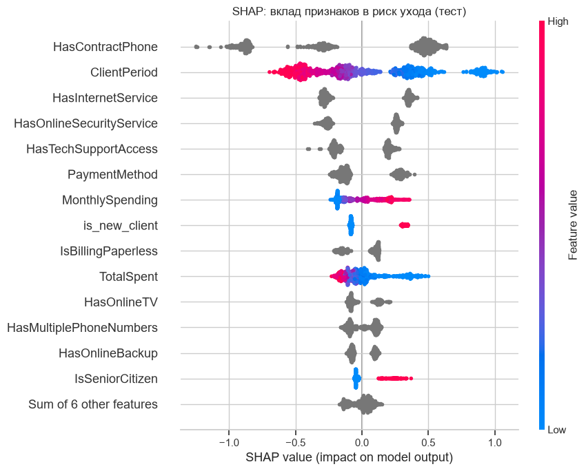

# Прогнозирование оттока клиентов телеком-оператора

Модель находит клиентов, склонных к уходу, а порог для кампании удержания выбирается из её экономики.
Итог: **ROC-AUC 0.855 / PR-AUC 0.651 на отложенном тесте**. Кампания по модели с порогом, выбранным из экономики, даёт **на 14% больше выгоды**, чем со стандартным порогом 0.5, тогда как массовая рассылка без модели убыточна.

📓 Всё исследование — в [`notebooks/churn_analysis.ipynb`](notebooks/churn_analysis.ipynb) (ноутбук исполнен, все выводы ячеек сохранены).

## Задача

Телеком-компания хочет заранее находить клиентов, которые собираются уйти, и предлагать им удерживающие условия. Предложение стоит денег, поэтому нужны две вещи: модель, которая ранжирует клиентов по риску ухода, и правило, кому именно делать предложение.

- **Целевая переменная:** `Churn` (1 — клиент ушёл), доля оттока 26%.
- **Основная метрика — ROC-AUC:** качество ранжирования, не зависит от порога.
- **Дополнительная — PR-AUC:** при дисбалансе классов показывает чистоту списка на обзвон (у случайной модели 0.26).

## Данные

5 282 клиента, 19 признаков: срок жизни (`ClientPeriod`), ежемесячный и суммарный платёж, демография, подключённые услуги (телефония, тип интернета, 6 интернет-опций), тип контракта, способ оплаты и тип счёта. Это версия открытого датасета Telco Customer Churn (IBM) с переименованными столбцами.

Данные в репозиторий не включены. Скачайте `train.csv` и положите его в `data/`:

```bash
pip install gdown
gdown 1ERwQ5odiK1Zvi1LtjpkzCMUswYsAX8_K -O data/train.csv
```

Ожидаемая структура: `data/train.csv` (5 282 строки + заголовок, 20 столбцов).

## Подход

1. **Чистка данных.** 9 пустых `TotalSpent` встречаются только у клиентов первого месяца (`ClientPeriod = 0`), поэтому заполняются нулём, а не медианой. Проверены согласованность `TotalSpent ≈ ClientPeriod × MonthlySpending` (95% клиентов в пределах ±10%), дубликаты (14, оставлены: нет ID клиента, совпадение профилей правдоподобно) и выбросы (нет).
2. **EDA с проверкой гипотез** (χ², Mann–Whitney) → сегменты риска и 5 новых признаков.
3. **Честное сравнение моделей.**
   - Отложенный тест 20% (стратифицированный) используется один раз в конце.
   - На остальных 80% — одна и та же стратифицированная 5-фолдовая CV для всех моделей.
   - Препроцессинг и генерация признаков внутри `sklearn.Pipeline` / `ColumnTransformer`.
   - Модели: `DummyClassifier`, логистическая регрессия с подбором `C`, CatBoost с подбором глубины и learning rate и ранней остановкой внутри каждого фолда.
   - Каждая гипотеза (новый признак, балансировка классов, кодирование категорий) сравнивается с базой **попарно по фолдам**.
4. **Порог под бизнес-сценарий.** Порог максимизирует ожидаемую выгоду кампании и подбирается на out-of-fold предсказаниях train, а не на тесте.
5. **Интерпретация.** Важность признаков CatBoost, SHAP summary и разбор двух конкретных клиентов.

## Результаты

ROC-AUC и PR-AUC на 5-фолдовой CV (среднее ± std) и на отложенном тесте:

| Модель | ROC-AUC (CV) | PR-AUC (CV) | Комментарий |
|---|---|---|---|
| Dummy (доля класса) | 0.500 | 0.262 | нижняя планка |
| Логистическая регрессия, C = 1 | 0.841 ± 0.013 | 0.647 ± 0.034 | |
| + `is_new_client` | 0.844 ± 0.011 | 0.655 ± 0.033 | значимое улучшение (+0.003): флаг даёт линейной модели нелинейность по сроку жизни |
| CatBoost, depth 3, lr 0.03 | 0.845 ± 0.012 | 0.664 ± 0.032 | мелкие деревья лучше глубоких |
| CatBoost + все 5 новых признаков | 0.843 ± 0.013 | 0.660 ± 0.033 | значимое ухудшение: избыточные признаки |
| CatBoost + балансировка классов | 0.843 ± 0.012 | 0.658 ± 0.031 | ранжирование не улучшает, портит калибровку |
| **CatBoost + `is_new_client` (итог)** | **0.845 ± 0.011** | **0.665 ± 0.032** | лучший PR-AUC среди равных по ROC-AUC |
| **Итоговая модель на тесте** | **0.855** | **0.651** | |

Полная таблица из 19 экспериментов с парными разницами — в разделе 6 ноутбука.

**Выбор порога.** Допущения: скидка 25% на 6 месяцев (1.5 месячного платежа), контакт стоит 5, удерживается 30% уходящих, ценность клиента — выручка за 12 месяцев. Результаты на тесте:

| Стратегия | Предложений | Precision | Recall | Выгода |
|---|---|---|---|---|
| Предлагать всем | 100% базы | 26% | 100% | **−11.9 тыс.** |
| Порог 0.5 | 20% базы | 66% | 50% | 25.0 тыс. |
| **Порог 0.30 (по выгоде)** | 35% базы | 55% | 74% | **28.5 тыс. (+14%)** |

Оптимальный порог (0.30) почти совпадает с теоретическим порогом окупаемости (0.32), значит вероятности модели хорошо откалиброваны.

## Ключевые бизнес-выводы

1. **Помесячный контракт** — главный фактор: отток 42% против 11% на годовом и 2.6% на двухлетнем контракте; на помесячников приходится 89% всех уходов.
2. **Первый год жизни:** помесячники со сроком жизни до 12 месяцев составляют 28% базы, но дают 55% всех уходов (отток в этом сегменте 51%). Это главная целевая группа для удержания.
3. **Оптоволокно без защиты и техподдержки:** отток 55% при самом высоком платеже. Подключённые защита или поддержка снижают отток интернет-клиентов с ~42% до ~15%, а ТВ и кино почти не влияют.
4. **Оплата электронным чеком:** отток 44.5% против 14–19% у остальных способов, эффект сохраняется внутри одного типа контракта.
5. **Рекомендации:** перевод помесячников первого года на долгосрочный контракт, пробный период защиты и поддержки для клиентов с оптоволокном, бонус за автоплатёж, онбординг первых 6 месяцев. Все рекомендации — гипотезы для A/B-тестов: SHAP и EDA показывают связи, а не причины.

## Интерпретация (SHAP)



Тип контракта, срок жизни, тип интернета, онлайн-защита и техподдержка определяют прогноз сильнее всего, что совпадает с выводами EDA. Категориальные признаки на графике серые, потому что у их значений нет естественного порядка. Направление их эффекта разобрано на примерах конкретных клиентов в разделе 8.

## Как запустить

```bash
git clone <url-репозитория> && cd churn-prediction
python -m venv .venv
source .venv/bin/activate        # Windows: .venv\Scripts\activate
pip install -r requirements.txt
# положить data/train.csv (см. «Данные»)
jupyter nbconvert --to notebook --execute --inplace notebooks/churn_analysis.ipynb
```

Для интерактивной работы установите `pip install jupyterlab` и запустите `jupyter lab`. Полное исполнение занимает около 3 минут на CPU. Результаты воспроизводимы: во всём ноутбуке используется один `RANDOM_STATE = 42`. Проверено на Python 3.12.

## Структура

```
├── data/                       # train.csv (не в репозитории)
├── images/                     # графики для README (создаются ноутбуком)
├── notebooks/
│   └── churn_analysis.ipynb    # исследование: данные → EDA → модели → порог → SHAP → выводы
├── requirements.txt
└── README.md
```

## Принятые решения и допущения

- **Пустые `TotalSpent` → 0.** Пропуски есть только у клиентов первого месяца, которые ещё ничего не заплатили.
- **One-hot для категорий в CatBoost** (`one_hot_max_size=4`). У всех категориальных признаков не больше 4 значений; CTR-кодирование проверено отдельным экспериментом, выигрыша не дало и обучается в ~15 раз дольше.
- **Отбор итоговой модели.** Среди конфигураций, отстающих от лучшей не больше чем на 0.002 ROC-AUC и обученных без балансировки классов, выбирается максимум PR-AUC.
- **Экономика кампании условная.** Стоимость предложения, его эффективность и горизонт ценности клиента заданы как допущения. В ноутбуке есть таблица чувствительности порога к ним.
- **EDA на всех данных.** Он используется только для формулировки гипотез; каждая гипотеза проверяется на CV без участия теста.

## Ограничения

Срез данных без дат, поэтому out-of-time валидация невозможна. Выборка небольшая (разброс ROC-AUC между фолдами ±0.012). Модель предсказывает уход, а не реакцию на предложение. Следующий шаг — uplift-моделирование по результатам пилота с контрольной группой.

## Стек

Python 3.12 · pandas · NumPy · scikit-learn · CatBoost · SHAP · SciPy · Matplotlib · Seaborn · Jupyter
